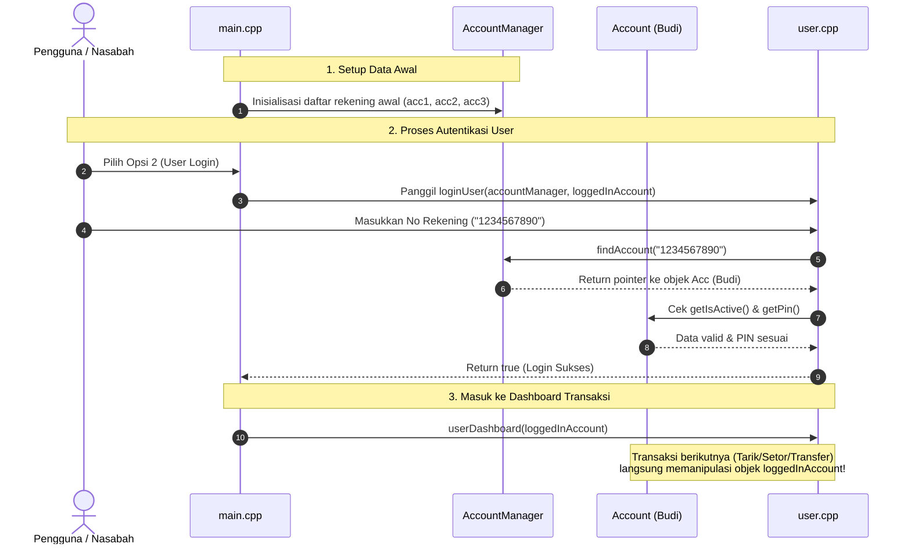

# 🏧 Sistem ATM Bank Nyahu - Dokumentasi Proyek & Panduan Tim

Selamat datang di repositori resmi Sistem ATM Bank Nyahu. Dokumen ini dirancang sebagai panduan kerja seluruh anggota tim, menjelaskan konsep dasar Pemrograman Berorientasi Objek (PBO), aturan penulisan kode (*coding standard*), cara kerja sistem, serta rincian pembagian tugas (*roadmap*).

---

## 📋 1. Coding Standard & Team Working Rules

Seluruh anggota tim wajib mematuhi aturan penulisan kode berikut agar kode tetap bersih, konsisten, dan mudah diintegrasikan:

### A. Standar Penamaan (Naming Convention)

| Komponen | Standar | Contoh | Keterangan |
| :--- | :--- | :--- | :--- |
| **Class** | `PascalCase` | `Account`, `Transaction`, `AccountManager` | Huruf pertama tiap kata kapital |
| **Method** | `camelCase` | `findAccount()`, `getBalance()`, `setPin()` | Dimulai huruf kecil |
| **Function** | `camelCase` | `loginAdmin()`, `loginUser()`, `displayHeader()` | Fungsi non-class |
| **Variable** | `camelCase` | `accountNumber`, `adminLoginAttempts` | Jelas dan deskriptif |
| **Parameter** | `camelCase` | `accountNumber`, `targetAccount` | Jelas fungsinya |
| **Constant** | `UPPER_SNAKE_CASE` | `MAX_LOGIN_ATTEMPTS`, `ACCOUNT_NUMBER_LENGTH` | Huruf kapital dipisah underscore |
| **Object** | `camelCase` | `accountManager`, `loggedInAccount` | Instansiasi dari class |
| **Vector** | `camelCase` | `accountList`, `transactions` | Jamak / mendeskripsikan list |

### B. Additional Rules
1. **Gunakan Bahasa Inggris** untuk seluruh penamaan identifier (class, function, method, parameter, dan variabel).
2. **Deskriptif:** Gunakan nama yang menjelaskan fungsi atau tujuan variabel (misal: `inputPin`, bukan `p`; `balance`, bukan `b`).
3. **Hindari Singkatan:** Jangan gunakan singkatan yang tidak umum seperti `nrk`, `jml`, `tmp`, dsb.
4. **Konsisten:** Jangan mencampur istilah bahasa Indonesia dan Inggris untuk konsep yang sama.
5. **Code Structure & Modular Programming:** Seluruh proses logika wajib dibungkus dalam function atau method agar rapi dan tidak menumpuk di `main()`.

---

## 📂 2. Struktur & Fungsi Masing-Masing File

Berikut adalah penjelasan fungsi setiap file dalam proyek ini agar seluruh anggota tim memahami perannya:

| Path File | Fungsi Utama & Tanggung Jawab | PIC / Pengedit |
| :--- | :--- | :--- |
| **`main.cpp`** | **Titik Masuk Program (*Entry Point*):** Menginisialisasi objek manajer (`accountManager`, `transactionManager`), mengisi data rekening awal (dummy), dan menjalankan loop menu utama Bank (Admin Login, User Login, Exit). | **Arya** |
| **`config/common.h`** | **Konfigurasi Global:** Menyimpan konstanta sistem seperti batas percobaan login (`MAX_LOGIN_ATTEMPTS`), panjang digit no rekening & PIN, serta kredensial default admin. | Bersama / Konstanta |
| **`helpers/helpers.h`** & **`helpers.cpp`** | **Fungsi Bantuan UI & Utilitas:** Menyediakan fungsi pembantu seperti `displayHeader()` (judul bergaris), `waitEnter()` (pause layar), `inputPassword()` (masking bintang `*`), dan `getCurrentTimestamp()` (waktu transaksi). | Bersama / Utilitas |
| **`transaction/transaction.h`** | **Model & Pengelola Transaksi:** Mendefinisikan class `Transaction` (struk/mutasi riwayat) dan `TransactionManager` (pembuat objek transaksi otomatis ber-ID unik). | **Arya** |
| **`account/account.h`** | **Model & Pengelola Rekening:** Mendefinisikan class `Account` (data nasabah, saldo, PIN, mutasi) dan class `AccountManager` (database bank untuk mencari dan menyimpan rekening). | **Arya** |
| **`admin/admin.h`** & **`admin.cpp`** | **Modul Menu & Aksi Admin:** Berisi logika autentikasi admin (`loginAdmin`, `logoutAdmin`), menu `adminDashboard`, serta fitur kelola rekening (`viewAllAccounts`, `createAccount`, `updateAccount`, `viewAccountTransactions`). | **Arya & Deva** |
| **`user/user.h`** & **`user.cpp`** | **Modul Menu & Aksi Nasabah:** Berisi logika login nasabah (`loginUser`), menu `userDashboard`, serta fitur transaksi nasabah (`checkBalance`, `viewUserTransactionHistory`, `withdrawCash`, `depositCash`, `transferFunds`). | **Arya, Rayxel, Nanda, Andika** |

---

## 💡 3. Pengenalan PBO: Memahami Konsep Objek dengan Mudah

Bagi anggota tim yang baru pertama kali belajar PBO, bayangkan sistem ini seperti **Bank Nyata**:

### Analogi Cetakan Formulir (Class vs Object)
* **Class (Cetakan / Blueprint):** Seperti formulir kosong pembukaan rekening di bank. Formulir tersebut menentukan bahwa setiap rekening pasti memiliki *Nomor Rekening*, *Nama*, *PIN*, dan *Saldo*.
* **Object (Kue Nyata):** Ketika formulir diisi oleh Budi Santoso, terciptalah objek rekening milik Budi (`acc1`). Ketika diisi oleh Siti Aminah, terciptalah objek rekening milik Siti (`acc2`). Keduanya memiliki struktur yang sama persis, tetapi data di dalamnya berdiri sendiri.

### Komponen Utama PBO dalam Proyek Ini
1. **Class `Account` (Rekening):** Menyimpan identitas nasabah, saldo, status (aktif/nonaktif), dan riwayat mutasi.
2. **Class `Transaction` (Transaksi):** Menyimpan bukti/struk tiap mutasi (ID, jenis transaksi, tanggal, nominal, sisa saldo).
3. **Class `AccountManager` (Pengelola Rekening):** Berperan sebagai sistem pengelola/database bank yang menyimpan daftar seluruh nasabah dalam bentuk `vector<Account>` dan menyediakan fungsi pencarian rekening (`findAccount()`).
4. **Class `TransactionManager` (Pengelola Transaksi):** Berperan membuat objek transaksi baru dan mengelola pencatatan riwayat transaksi.
5. **Encapsulation (`private` & `public`):** Saldo dan PIN disimpan di `private` agar tidak bisa diubah langsung secara sembarangan dari luar. Perubahan saldo dan PIN hanya boleh dilakukan lewat fungsi resmi (`setPin()`, `setBalance()`).

---

## ⚙️ 4. Bagaimana Program Ini Berjalan?



1. **Inisialisasi Data (`main.cpp`):** Program menyiapkan objek `accountManager` dan beberapa akun awal (`acc1`, `acc2`, `acc3`).
2. **Pencarian Objek saat Login (`user/user.cpp`):** Ketika nasabah memasukkan nomor rekening, `accountManager.findAccount()` mencari objek rekening yang bersangkutan.
3. **Operasi Berbasis Objek:** Ketika user berhasil login, alamat objek rekening nasabah (`loggedInAccount`) diteruskan ke `userDashboard()`. Seluruh menu transaksi (Tarik Tunai, Setor Tunai, Transfer) cukup mengubah saldo dan menambahkan mutasi langsung ke objek rekening tersebut.

---

## 🗺️ 5. Project Roadmap & Pembagian Tugas Tim

Berikut adalah pembagian tahapan kerja resmi untuk setiap anggota tim:

```
[Tahap 1: Arya] ──> [Tahap 2: Deva] ──> [Tahap 3: Rayxel] ──> [Tahap 4: Nanda] ──> [Tahap 5: Andika] ──> [Tahap 6: Arya]
 Fondasi & Auth       Manajemen Rekening   Info & Riwayat        Transaksi Tunai      Transfer Antar Rek    Testing & QA
```

---

### 🔹 Tahap 1 - Arya (Selesai ✅)
**Fondasi Class & Sistem Autentikasi**
* [x] Inisialisasi Awal Project & Konfigurasi VS Code
* [x] Implementasi Class:
  * `Account` (`account/account.h`)
  * `Transaction` (`transaction/transaction.h`)
  * `AccountManager` (`account/account.h`)
  * `TransactionManager` (`transaction/transaction.h`)
* [x] Subprocess Login Admin & Logout Admin (`admin/admin.cpp`)
* [x] Subprocess Login User dengan validasi status dan batas percobaan 3x (`user/user.cpp`)
* [x] Inisialisasi objek dummy nasabah di `main.cpp`

---

### 🔹 Tahap 2 - Deva
**Manajemen Rekening (Role Admin)**
* **Lokasi File:** `admin/admin.cpp` dan `admin/admin.h`
* **Tugas:**
  1. **Melihat Daftar Rekening:**
     * Panggil `accountManager.getAllAccounts()`.
     * Tampilkan seluruh data rekening dalam format tabel (Nomor Rekening, Nama, Saldo, Status).
  2. **Create Rekening Baru:**
     * Input Nama, Nomor Rekening (validasi 10 digit, cek tidak duplikat), dan PIN (validasi 6 digit).
     * Buat objek `Account` baru $\rightarrow$ tambahkan ke `accountManager.addAccount(newAccount)`.
  3. **Update Rekening:**
     * Cari rekening via `accountManager.findAccount(targetNo)`.
     * Berikan 2 submenu:
       * **Ganti PIN Rekening:** Validasi 6 digit dan konfirmasi ulang PIN $\rightarrow$ `acc->setPin(newPin)`.
       * **Ubah Status Rekening:** Ubah status antara Aktif $\leftrightarrow$ Nonaktif $\rightarrow$ `acc->setIsActive(newStatus)`.

---

### 🔹 Tahap 3 - Rayxel
**Informasi Rekening & Riwayat Transaksi**
* **Lokasi File:** `user/user.cpp` dan `admin/admin.cpp`
* **Tugas:**
  1. **Cek Saldo (Menu User):**
     * Akses saldo milik nasabah login menggunakan `loggedInAccount->getBalance()`.
     * Tampilkan informasi saldo beserta waktu akses (`getCurrentTimestamp()`).
  2. **Melihat Riwayat Transaksi User (Menu User):**
     * Ambil data transaksi melalui `loggedInAccount->getTransactions()`.
     * Jika kosong: tampilkan pesan *"Belum terdapat riwayat transaksi"*.
     * Jika ada: lakukan perulangan (`looping`) pada list transaksi dan tampilkan: ID Transaksi, Jenis, Nominal, Tanggal/Waktu, Keterangan, dan Saldo Setelah Transaksi.
  3. **Melihat Riwayat Transaksi via Admin (Menu Admin):**
     * Admin memasukkan nomor rekening target $\rightarrow$ cari dengan `accountManager.findAccount()`.
     * Tampilkan riwayat transaksi dari rekening yang ditemukan tersebut.

---

### 🔹 Tahap 4 - Nanda
**Transaksi Tunai**
* **Lokasi File:** `user/user.cpp`
* **Tugas:**
  1. **Tarik Tunai:**
     * Sediakan opsi nominal cepat (Rp100.000, Rp200.000, Rp500.000, Rp1.000.000) dan opsi "Penarikan Jumlah Lainnya".
     * Penarikan Lainnya: Validasi kelipatan denominasi (Rp50.000 / Rp100.000).
     * Validasi saldo: Apakah saldo mencukupi (`loggedInAccount->getBalance() >= nominal`).
     * Kurangi saldo: `loggedInAccount->setBalance(saldoBaru)`.
     * Buat objek transaksi penarikan $\rightarrow$ tambahkan ke `loggedInAccount->addTransaction(trx)`.
  2. **Setor Tunai:**
     * Input nominal/lembar uang $\rightarrow$ tampilkan konfirmasi penyetoran.
     * Jika disetujui: tambahkan saldo `loggedInAccount->setBalance(...)`.
     * Buat objek transaksi setoran $\rightarrow$ simpan via `loggedInAccount->addTransaction(trx)`.

---

### 🔹 Tahap 5 - Andika
**Transfer Antar Rekening**
* **Lokasi File:** `user/user.cpp`
* **Tugas:**
  1. **Input Rekening Tujuan:**
     * Cari rekening tujuan: `Account* targetAcc = accountManager.findAccount(targetNo)`.
     * Validasi: Rekening tujuan ditemukan, berstatus aktif, dan bukan nomor rekening sendiri.
  2. **Input Nominal Transfer & Validasi Saldo:**
     * Nominal transfer harus $> 0$.
     * Cek apakah saldo pengirim mencukupi.
  3. **Konfirmasi Transfer:**
     * Tampilkan detail (Rekening Pengirim, Rekening Tujuan, Nama Penerima, Nominal).
  4. **Eksekusi Transfer:**
     * Kurangi saldo pengirim $\rightarrow$ `loggedInAccount->setBalance(saldoLama - nominal)`.
     * Tambahkan saldo penerima $\rightarrow$ `targetAcc->setBalance(targetAcc->getBalance() + nominal)`.
     * Catat riwayat `Transaction` pada **kedua rekening**:
       * Pengirim: Jenis "Transfer Keluar" (dengan keterangan nama penerima).
       * Penerima: Jenis "Transfer Masuk" (dengan keterangan nama pengirim).

---

### 🔹 Tahap 6 - Arya
**Use Case Testing & Code Quality Assurance**
* **Tugas:**
  1. **Testing Sistem Autentikasi:** Batas 3x percobaan login, blokir otomatis, login admin/user.
  2. **Testing Manajemen Rekening:** Validasi duplikasi nomor rekening, format 10 digit, ganti PIN, ubah status.
  3. **Testing Transaksi Tunai:** Validasi pecahan uang, penarikan melebihi saldo, pembatalan setor.
  4. **Testing Transfer:** Transfer ke rekening sendiri, rekening nonaktif, saldo tidak cukup, konsistensi saldo kedua belah pihak.
  5. **Code Improvement & Refactoring:** Menghilangkan duplikasi kode, memastikan seluruh penamaan sesuai *Coding Standard*, dan memeriksa kestabilan memori.

---

## 💻 6. Panduan Kompilasi & Menjalankan Program

### Cara 1: Menggunakan Tombol "Run Code" di VS Code
Buka file apa saja di project ini, lalu tekan tombol **Run Code** (ikon Segitiga Play di pojok kanan atas). Program akan otomatis dikompilasi dari root folder dan dijalankan di terminal interaktif.

### Cara 2: Menjalankan Manual via Terminal PowerShell
```powershell
g++ -x c++-header config/common.h -o config/common.h.gch
g++ -I. main.cpp helpers/*.cpp admin/*.cpp user/*.cpp -o main.exe
.\main.exe
```

---

### Data Rekening untuk Uji Coba:
| Role / Akun | Identifier / No Rekening | PIN | Status | Keterangan |
| :--- | :--- | :--- | :--- | :--- |
| **Admin** | `admin` | `123456` | - | Hak akses penuh admin |
| **User 1 (Budi)** | `1234567890` | `123456` | Aktif | Saldo: Rp5.000.000 |
| **User 2 (Siti)** | `0987654321` | `654321` | Aktif | Saldo: Rp2.500.000 |
| **User 3 (Joko)** | `1122334455` | `111222` | Nonaktif | Untuk pengujian rekening nonaktif |
